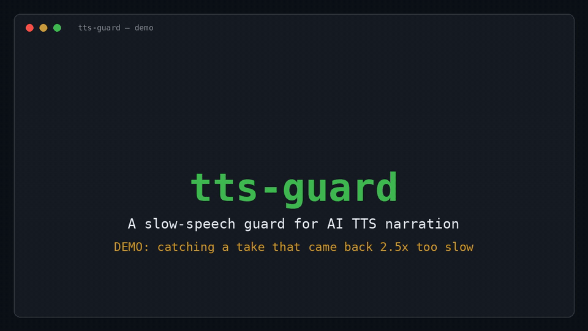

# tts-guard

**A slow-speech guard for AI TTS narration pipelines — detect, repair, verify.**

AI text-to-speech engines occasionally return an entire narration that is
uniformly 2–4× too slow: no silence, no error, just stretched speech. Naive
checks (file exists, audio is non-silent) all pass, and the bad audio ships —
in our case, inside finished videos that had to be re-made.

`tts-guard` wraps your TTS engine and makes this silent failure impossible to
miss:

1. **Synthesize** the full text once.
2. **Verify** — measure the audio duration with `ffprobe`. Expected duration
   ≈ character count ÷ speaking rate (default 4.5 chars/sec for Mandarin).
   If actual > expected × 1.8, the take is flagged abnormal.
3. **Repair** — split the text at sentence boundaries (。！？), synthesize
   sentence by sentence with per-sentence verification (one retry each),
   and join with 0.4 s pauses.
4. **Final check** — the joined file must match the summed duration of its
   parts within tolerance, or the script exits non-zero for a human to look.

Exit code `0` means the audio passed. Anything else means it did not — your
pipeline can stop instead of shipping a bad video.

## Demo



A 78-second walkthrough of a real incident reproduced end to end: the whole
take comes back 2.5× too slow (45.56 s vs. an expected ≈18.2 s), the guard
flags it, repairs it sentence by sentence, and the final check passes
(19.83 s, exit code 0). Durations shown are actual `ffprobe` measurements
from the reproduction run (a stub engine stands in for the TTS provider so
the failure is deterministic).

[Watch the full demo (MP4, 1280×720)](docs/demo.mp4)

## Why this exists

This tool was born in a real daily production workflow (short-form narration
videos, produced every day). The slow-speech failure occurred three times in
one week — see [docs/INCIDENTS.md](docs/INCIDENTS.md) for the incident log,
including a subtle locale bug (`wc -m` counting bytes instead of characters
under the C locale) that briefly hid the failure from the guard itself.

## Usage

```bash
# TTS_BIN points to your TTS CLI; adapt the synth() function in the script
# to your engine's flags (the guard logic itself is engine-agnostic).
TTS_BIN=/path/to/your-tts ./tts_guard.sh output.mp3 narration.txt

# Force the sentence-by-sentence path (useful for testing):
FORCE_SPLIT=1 ./tts_guard.sh output.mp3 narration.txt
```

Requirements: `bash`, `ffmpeg`/`ffprobe`, `python3`, and a UTF-8 locale
(`C.utf8` is enough).

## Providers

`TTS_PROVIDER` selects the synthesis back end; the guard logic is identical
either way.

### `cli` (default)

Any TTS command-line tool, via `TTS_BIN`. The reference `synth()` call style
is `speak --voice … --language zh --speed N --output F --text-stdin`; adapt
that one function if your engine's flags differ.

```bash
TTS_PROVIDER=cli TTS_BIN=/path/to/your-tts ./tts_guard.sh out.mp3 narration.txt
```

### `edge` — Microsoft Edge TTS (edge-tts)

```bash
pip install edge-tts
TTS_PROVIDER=edge ./tts_guard.sh out.mp3 narration.txt
```

- Voice defaults to `zh-CN-XiaoxiaoNeural`. Override with `EDGE_VOICE`, or
  pass `--voice <name>` — a non-default `--voice` value is used as the Edge
  voice when `EDGE_VOICE` is not set:

  ```bash
  TTS_PROVIDER=edge EDGE_VOICE=zh-CN-YunyangNeural ./tts_guard.sh out.mp3 narration.txt
  ```

- `--speed N` maps to edge-tts `--rate`: 100 → `+0%`, 120 → `+20%`,
  80 → `-20%`.
- Requires network access to Microsoft's speech service.

## Notes

- The default speaking-rate model (chars ÷ 4.5) is calibrated for Mandarin
  narration; adjust the rate and the 1.8× threshold in the script for other
  languages or voices.
- Character counting forces `LC_ALL=C.utf8` — under a plain C locale,
  byte-counting inflates the expected duration 3× for CJK text and the guard
  goes blind. This was a real bug; it is fixed and documented.

## Roadmap

- Provider adapters behind a stable `synth()` interface — edge-tts done
  (v1.1.0, `TTS_PROVIDER=edge`); Piper and OpenAI TTS still to come
- Language presets for speaking-rate models (en / ja / ko)
- Synthetic-audio regression tests in CI

## License

MIT — see [LICENSE](LICENSE).
